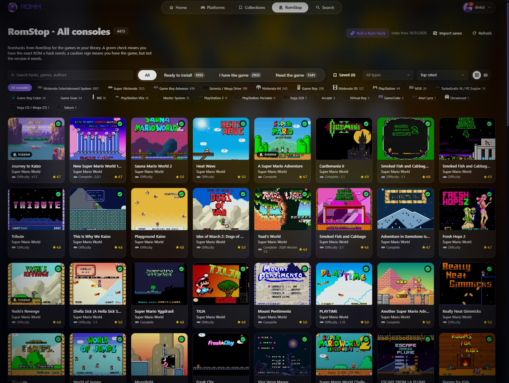
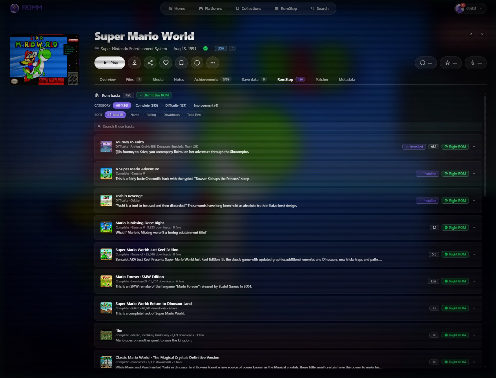
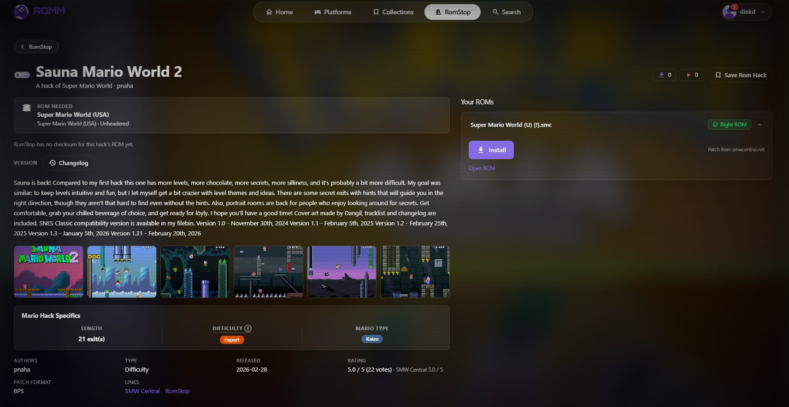
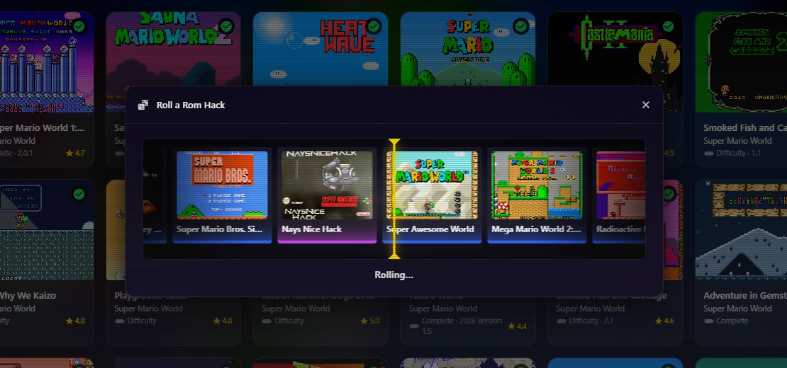
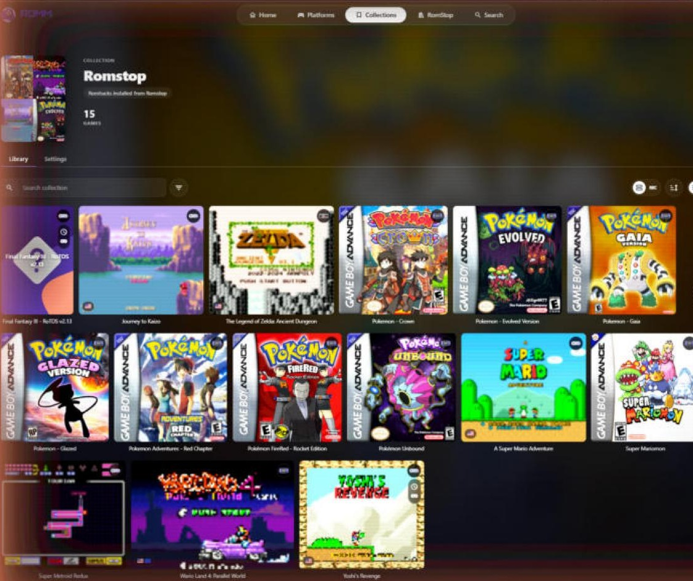
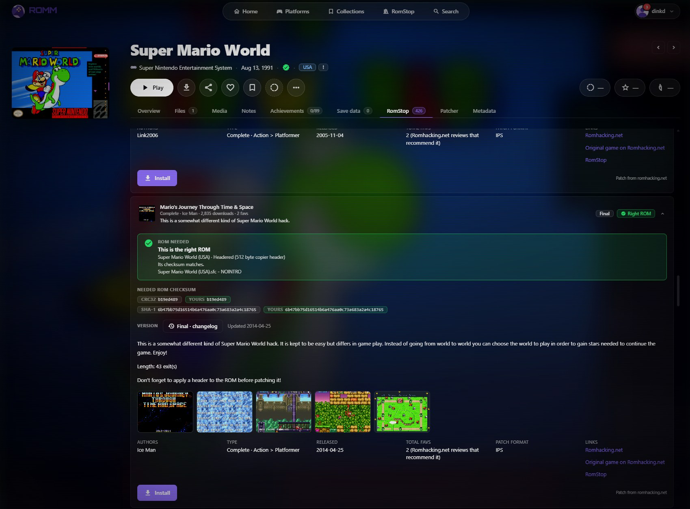
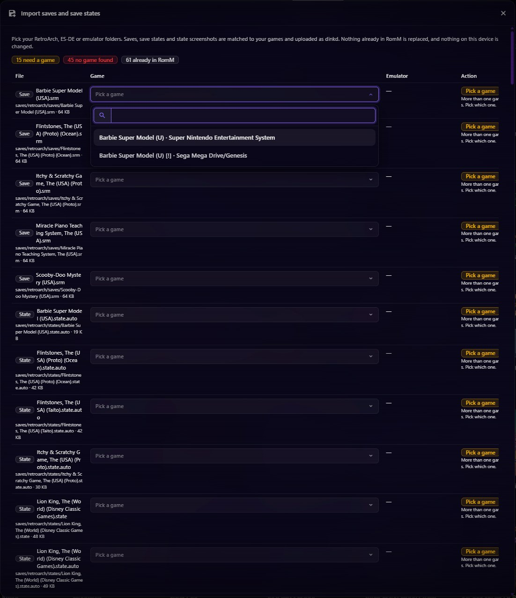
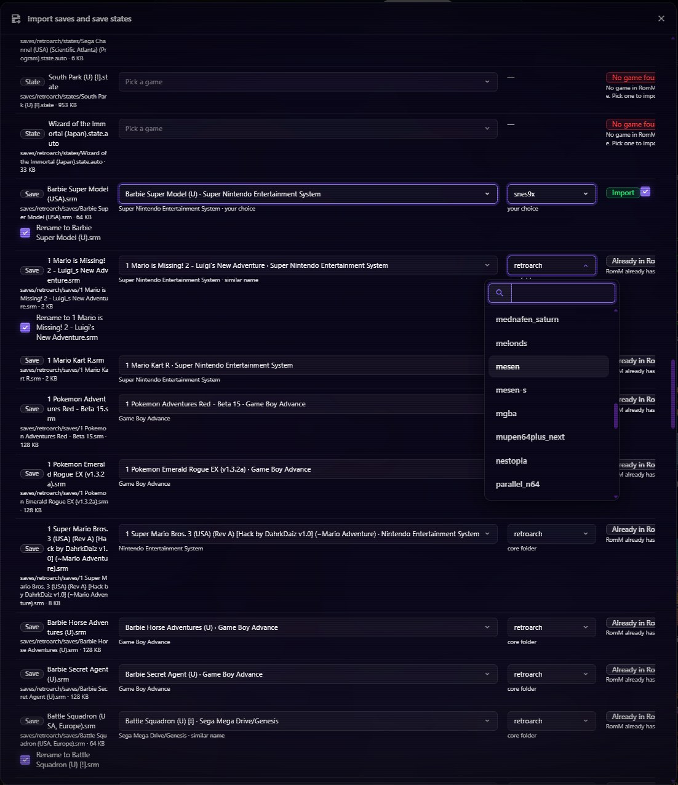

# RomStop for RomM

RomStop is an add-on for [RomM](https://github.com/rommapp/romm), the self-hosted ROM manager. It makes romhacking accessible: it shows every romhack in the RomStop index next to the games in your RomM library, tells you which ones you can install with the ROMs you already have, and installs a hack in one click as a new game in your library.

You never have to find a patch, check a checksum or run a patcher by hand. RomStop never downloads or hosts ROMs. It only patches the ROMs that are already in your RomM library.

## How it works

1. **The hack index.** The RomStop site publishes an index of thousands of romhacks and translations. Each entry has a description, authors, versions and changelogs, ratings, screenshots and emulator notes, plus the exact ROM the hack needs (checksums included) and a direct link to its patch. Hacks come from SMW Central, the Romhacking.net archive, Pokémon hack showcases and other sites, and each one credits its source. The index includes only complete hacks and English translations, and it is refreshed weekly. RomM checks it for changes every 10 minutes.
2. **Matching your library.** RomStop hashes the ROMs in your RomM library in the background, accounting for copier and iNES headers, and matches each hack to the ROM it needs:
   - ✅ **Exact**: the checksum matches, so this ROM will patch correctly.
   - ✅ **Likely**: same game and region; the hack lists no checksum to confirm it.
   - ⚠️ **Wrong version**: you have the game, but not the dump the hack needs (for example, the USA ROM when the hack needs the Japanese one). RomStop names the ROM you need.
   - **None**: the game isn't in your library.
3. **Installing.** Press **Install**. RomM's server downloads the patch (from RomStop's mirror first, then the hack's own source), patches your ROM with RomM's own patcher, and adds the result as a new game, for example `Hack Title (USA) (v1.2) [RomStop].sfc`. The new game gets its description, cover, screenshots, authors and release date, and goes into a "RomStop" collection. Your original ROM is never changed.
4. **Playing.** If a hack's notes say it only works on certain emulators, RomStop sets the installed game to use a browser core that works, so it plays in RomM's built-in player with no setup.

## What you get in RomM

- **A RomStop page in the top bar.** Every hack, by console, with search, type filters, sorting, and a grid or list view.
  - **Show filters**: *Ready to install* (a ROM in your library fits the hack), *I have the game* (any version of the game, including the wrong one) and *Need the game* (no copy in your library). While a filter is on, the header shows "N of total".
  - **Save Rom Hack**: bookmark hacks to come back to later. The *Saved* toggle combines with the Show filters, so *Saved* plus *Need the game* lists the games you still need to add.
  - **Roll a Rom Hack**: spins a reel and lands on a random hack you can install right now.
- **A RomStop tab on every game page.** It lists the hacks made for that game. Each row shows whether your ROM is the right one, the version with its changelog, the description, screenshots, ratings, authors and source links, and an **Install** button.
- **Updates.** A badge appears when a newer version of an installed hack is out. There's a version picker and a Reinstall button.
- **Emulator notes.** Hacks that don't work on some emulators are tagged, with the source page's own words.
- **Import saves.** Bring your RetroArch, ES-DE or standalone emulator saves and save states into RomM. RomStop matches each one to the right game and never replaces anything already in RomM.

### Screenshots

| | |
|---|---|
|  |  |
| A game's **RomStop** tab: every hack for it, with installed ones marked | A hack's page: the ROM it needs, your ROM that fits, and **Install** |
|  |  |
| **Roll a Rom Hack** picks something you can install right now | Installed hacks are normal games in a **RomStop** collection |
|  |  |
| The ROM check: which dump the hack needs, and whether yours matches | **Import saves** matches every save and state to a game in RomM |
|  | |
| Pick the emulator a state belongs to, and rename saves to match RomM's file | |

### Examples

- Your library has *Super Mario World (USA)*. Open the RomStop page, choose **Show: Ready to install** and **Console: SNES**, and you get every SMW hack you can install right now. Pick one and press **Install**.
- You have *Mega Man 2 (USA)*, but a hack for it needs the Japanese ROM. Its row shows ⚠️ and names *Mega Man 2 (Japan)*. Save it with **Save Rom Hack**, and it's waiting under **Saved + Need the game** once you add that ROM.
- On a game's page, the **RomStop** tab badge shows how many hacks exist for that game.

## Install

### Windows 11 (one installer)

Download **[RomM-RomStop-Setup.exe](https://github.com/itsdinkd/RomStop/releases/latest/download/RomM-RomStop-Setup.exe)** and run it. It asks for your ROM folder, a port and optional metadata accounts, sets up WSL2 and Docker Desktop, and starts RomM with RomStop at `http://localhost:8080`. Running it again repairs or upgrades the install and keeps your data. Details are in [romm/README.md](romm/README.md).

### Any Docker host

Use `ghcr.io/itsdinkd/romstop-romm:latest` in place of `rommapp/romm` in RomM's usual `docker-compose.yml`. Everything else about RomM stays the same. Optional settings are listed in [romm/README.md](romm/README.md#any-other-docker-host).

## Repo layout

| Folder | What it is |
|---|---|
| `romm/` | The RomM add-on: an overlay on RomM's source (`overlay/` + `romm.patch`), the Docker image, the Windows installer (`windows/`) and tests |
| `docs/architecture.md` | How it is built, the hack index format they read, and what to keep in sync |

The hack index is built and published separately by the RomStop site. This repo only reads it.

## Rules RomStop follows

- **No ROMs, ever.** RomStop never downloads, hosts or links to ROMs. It only patches ROMs you already have.
- **Patches are credited.** Every hack links back to its source page and authors. Patches are mirrored only when the author allows rehosting; otherwise RomStop links to the source.
- **Nothing runs from downloads.** A download that contains a program is refused.

## License

[AGPL-3.0](LICENSE), the same license as RomM, which this add-on modifies and ships.
